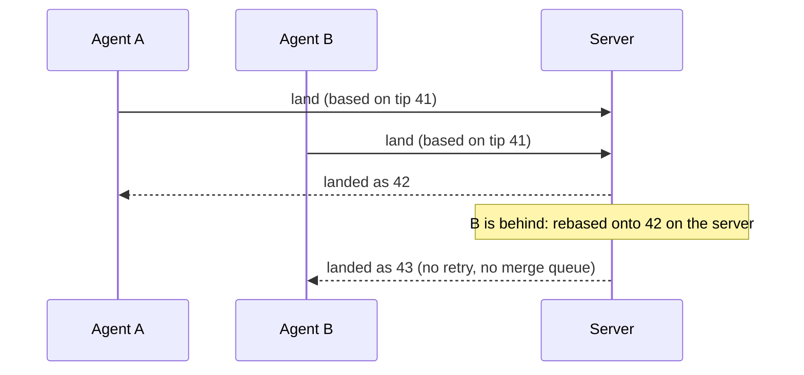

<p align="center">
  <a href="https://grovedock.com/"></a>
</p>

<h1 align="center">gd</h1>

<p align="center">
  <b>Source control for software built by people and AI agents.</b><br>
  History lives on the server: a clone takes milliseconds, any file is one read away, and
  hundreds of agents land on one branch at once, with no merge queue and no retries.
</p>

<p align="center">
  <a href="https://github.com/grovedock/gd/actions/workflows/ci.yml"></a>
  <a href="https://github.com/grovedock/gd/releases"></a>
  <a href="LICENSE"></a>
  <a href="https://grovedock.com/docs/"></a>
</p>

## Measured, not promised

On the git project's own repository (82,443 commits), both tools on one machine, git at its
best case (local `file://`, no hooks). Method, raw results and scripts:
[docs/comparisons/git-vs-gd.md](docs/comparisons/git-vs-gd.md).

| | git | gd |
|---|---:|---:|
| Full clone | 19.1 s | **0.46 s** |
| Sparse clone of `Documentation/` | 9.5 s | **0.11 s** |
| Read one file in CI, no clone | 149 ms | **9 ms** |
| 16 agents landing 80 changes on one branch | 42.8 s, 456 retries | **3.5 s, 0 retries** |
| Client metadata after a full clone | 334 MB | **380 KB** |

Past what git can do at all: 1,000 agents landing at once on one server sustain about 900
lands a second (p99 1.3 s) when their work is spread across a monorepo's directories, and 500
a second when all of it lands in one directory, with no errors either way.

## Why it's different

- **Land, don't push.** `gd land` hands your change to the server, which rebases it onto the
  branch's tip and lands it atomically. Two agents changing different files never conflict
  and never retry; a real conflict is refused, naming the files that clash.
- **History stays on the server.** A clone fetches what you open, when you open it. CI reads
  the one file it needs. A laptop holds an index, not the whole history.
- **Agents are first-class.** Each agent works under its own name, answering to a person,
  with a token limited to the repositories it needs. `gd mcp` gives Claude Code, Cursor and
  other MCP clients read, commit and land as tools.
- **Never locked in.** `git clone gd::https://…` works through the git bridge, `gd import-git`
  brings history in, and `gd export-git` writes it back out with identical trees.



## Try it in a minute

```sh
brew install kabirnarang39/tap/gd     # or: curl -fsSL https://raw.githubusercontent.com/grovedock/gd/main/install.sh | sh
                                      # or: cargo install grovedock

gd login https://cloud.grovedock.com                             # opens your browser; free, no card
gd import-git . --server https://cloud.grovedock.com/acme/web   # bring a git repository, history included
gd clone https://cloud.grovedock.com/acme/web web
cd web && echo hi > hello.txt && gd commit -m "Say hi" && gd land
```

Give an agent its own token and connect it:

```sh
claude mcp add --transport http gd https://cloud.grovedock.com/mcp \
  --header "Authorization: Bearer $GD_TOKEN"
```

## What's in this repository

gd is to [Grovedock](https://grovedock.com) what git is to GitHub. This repository is the open
part, all Apache-2.0:

| | What |
|---|---|
| **Protocol** | [`crates/proto/proto`](crates/proto/proto): the `gd.v1` wire format and every call, with [the written spec](https://grovedock.com/docs/reference/protocol.html). Anyone can build a client or a server for it. |
| **`gd`** | The command line, the git bridge, mounts and the local MCP server for agents. |
| **Libraries** | [`grovedock-core`](crates/core), the data model; [`grovedock-adapters`](crates/adapters), SQLite, Postgres, S3 and the gRPC transport. |
| **SDKs** | [Python](sdk/python), [TypeScript](sdk/typescript) and [Go](sdk/go). |
| **Benchmarks** | [`bench/`](bench): the harness and recorded results behind the numbers above. |

Grovedock is the platform built on the protocol (organisations, reviews, issues, protected
branches, agents, plans), run for you at [cloud.grovedock.com](https://cloud.grovedock.com),
free for small teams, or on your own servers with Enterprise.

## Where git still wins

git works fully offline and is decentralised: every clone is a whole repository, and no
server is needed to commit. Its ecosystem is enormous. gd commits and lands through a server,
which is what makes clones instant and landing conflict-free; for days of work with no
network, git is the better tool, and gd's git bridge lets the two meet.

## Contributing

Issues and pull requests are welcome. [CONTRIBUTING.md](CONTRIBUTING.md) explains the layout,
how to run the tests and what makes a change easy to accept; issues labelled
[`good first issue`](https://github.com/grovedock/gd/labels/good%20first%20issue) are a good
place to start. Security reports go to [SECURITY.md](SECURITY.md), never to public issues.

A grove is many trees on one root, like many agents on one history; a dock is where their
changes land.
